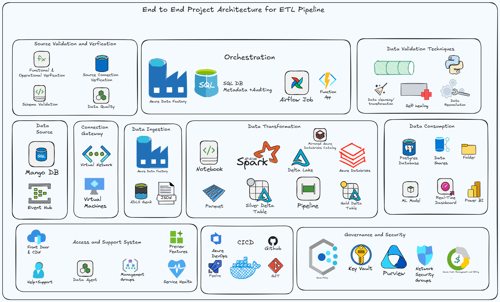

# ETL_SL_Assignment
Assignment: Production-grade data-pipeline from MongoDB to Postgres/Redshift

#  Career Objectives
Data Engineer with a strong track record of designing, building, and optimizing end-to-end ETL/ELT data pipelines from scratch. Experienced in engineering resilient ingestion frameworks that seamlessly extract and process data from diverse source systems, including nested NoSQL documents, traditional relational systems like SQL Server, and live web APIs. Passionate about transforming messy, denormalized data into highly structured, optimized relational schemas (such as Star and Snowflake models) that eliminate redundancy and drastically speed up analytical queries. Looking to leverage my hands-on skills in pipeline automation, database performance tuning, and robust data warehousing to help a forward-thinking team build scalable, production-grade data infrastructures that organizations can completely trust.

# Project Architecture and Decision
Based on the required End to End Project Architecture for ETL Pipeline, the platform bypasses traditional database structures in favor of an automated, serverless, and highly secure cloud ecosystem. Semi-structured JSON documents from MongoDB present unique scalability and consistency issues when migrated to a relational target like PostgreSQL. Below are the core justifications driving these technology choices:

* **Ingestion Engine: Azure Data Factory (ADF) Native CDC**
  * Deployed ADF Native CDC to tail the MongoDB replication oplog directly.
  * Traditional timestamp filters (`updatedAt > lastRun`) completely miss hard deletes because deleted records leave no timestamp markers. Native CDC captures all inserts (`I`), updates (`U`), and deletes (`D`) automatically at the log level, ensuring 100% data discovery fidelity without custom watermark tracking tables.

* **Storage Tier: ADLS Gen2 with Dynamic Date Partitioning and Gzip Compression**
  * Configured the landing storage container with virtual date sub-folders (`bronzeLanding/year=yyyy/month=MM/day=dd/`) and applied native `gzip` compression to incoming files.
  * Dumping files into a single root directory causes directory-listing bottlenecks in Apache Spark over time. Date partitioning isolates ingestion boundaries to protect historical logs, while `gzip` compression reduces raw text storage sizes by up to 85%, cutting cloud storage costs while remaining natively readable by the compute layer.

* **Compute Framework: Databricks Auto Loader and 3 Wide Denormalized Silver Delta Tables**
  * Paired Databricks Auto Loader (`cloudFiles`) with exactly three broad, fully denormalized Silver Delta tables (`silverBillsFlat`, `silverOrdersFlat`, `silverCartsAndUsersFlat`).
  * Auto Loader uses cloud checkpoints to scan only net-new incoming files, bypassing old files to minimize cluster compute costs. Exploding nested JSON arrays directly into wide tables where parent attributes are duplicated removes expensive distributed shuffle joins from the staging phase, maximizing parallel compute throughput.

* **Warehouse Design: PostgreSQL Star Schema Fact Constellation**
  * A Fact Constellation allows separate core transaction processes (`FactBillItems`, `FactOrderItems`, `FactCartItems`) to cleanly share the exact same conformed lookup dimensions (`DimDate`, `DimProducts`, `DimSuppliers`, `DimUsers`, `DimLocations`). This prevents un-synced data duplicates across analytics layers.

* **User Data Isolation: Embedded User Profiling Inversion**
  * Extracted user metadata parameters (`userAccountUsername`, `userAccountEmail`, `userFirstName`, `userLastName`) out of the embedded Cart document layer to populate the central `DimUsers` table.
  * Customer profiles do not arrive as a standalone collection from the source. Splitting the User JSON file into independent target structures during staging provides a dedicated user lookup dimension for cross-functional warehouse queries.

* **Governance and Security: Key Vault, Purview, and Pipeline Data Validation**
  * Integrated Azure Key Vault for credentials isolation, Azure Purview for automated data lineage mapping, and forced all data streams through strict **Schema Validation**, **Data Quality**, **Self Healing**, and **Data Reconciliation** blocks.
  * Hardcoded scripts lack transactional auditing and risk breaking during unexpected schema changes. Key Vault prevents plaintext password exposure in open repositories, Purview tracks lineage for strict compliance, and automated validation gates prevent malformed data strings from writing to PostgreSQL.

## 🔮 Core Project Assumptions
* **Source System Connectivity & Access Model**
  * It is assumed that the source MongoDB database is deployed as a Replica Set or Sharded Cluster with the Operations Log (oplog) enabled to support Azure Data Factory (ADF) Native CDC log tailing.
  * Security gates assume that all source-to-lake network communication occurs over private network tunnels, isolated securely using Azure Virtual Network (VNet) routing and Network Security Groups (NSGs).
* **Schema Evolution & Dynamic Property Parsing**
  * The ingestion engine assumes that nested JSON elements using variable keys (such as meta_data.{SUPPLIER} and priceMap.{VENDOR}) will alter structure dynamically based on vendor names. The PySpark framework uses map expression lookups to capture these changes safely without failing.
  * It is assumed that the overall schema can evolve; therefore, wide denormalized Silver Delta tables are used to store unstructured variations before writing to the rigid PostgreSQL schema.
* **Data Availability & Ingestion Volume**
  * The architecture assumes that Azure Data Factory drops new incremental document batches with completely unique, timestamped filenames (utilising the pipeline RunId) to prevent Databricks Auto Loader from skipping payloads.
  * Execution sizing assumes a high-volume data stream. Data lands in compressed gzip format and relies on the Databricks availableNow=True micro-batch trigger to minimize active cloud compute cluster runtime.
* **Identity & Operational Profiling**
  * The design assumes that a standalone users collection does not exist at the source layer. Customer accounts are embedded inside the shopping cart payloads and must be split into dedicated target warehouse tables (DimUsers and FactCartItems) during staging.
  * Array fields like phone_no, roleId, and departmentId are assumed to be multi-valued and are pre-flattened into single, comma-separated string parameters inside the Silver layer for analytical compatibility.
* **Warehouse Precision & Model Integrity**
  * To protect financial metrics against float rounding inconsistencies, the pipeline assumes all monetary fields must be explicitly converted to NUMERIC(15,4) during the final PostgreSQL database write loop.
  * It is assumed that Clinic Details (clinicName) must remain a flat, denormalized field in DimUsers across all architectures. This design choice guarantees fast retrieval speeds for predictive machine learning workflows by eliminating a relational join step.

#  🚀 Step-by-Step Platform Setup Instructions
* **Phase 1: Target PostgreSQL Warehouse Deployment**
  *  **Provision Database**: Initialize your production PostgreSQL instance and establish an administrative schema user with read/write privileges.
  *  **Execute DDL Core Script**: Connect via your local IDE or query editor and execute the master DDL script to create the conformed lookup tables (`DimDate`, `DimSuppliers`, `DimProducts`, `DimLocations`, `DimUsers`) and metric ledgers (`FactBillItems`, `FactOrderItems`, `FactCartItems`).
  * **Validate Indexes**: Confirm that B-Tree indexes on all foreign key constraints are initialized successfully to ensure fast join execution times during reporting runs.
* **Phase 2: Azure Infrastructure & Ingestion Gateway Configuration**
  *  **Establish Security Bounds**: Configure your Azure Virtual Network (VNet) and Network Security Groups (NSGs) to whitelist private data traffic between your source MongoDB nodes and the landing zone.
  *  **Register Key Vault Secrets**: Store your production database passwords, connection string vectors, and MongoDB access keys safely as encrypted secrets inside Azure Key Vault.
  *   **Map ADF Linked Services**: Open Azure Data Factory (ADF) Studio and configure two secure runtimes: `ls_mongodb_source` and `ls_adls_gen2_bronze` using Key Vault tokens for authorization.
  *  **Deploy Dataset Sink Properties**: Create a target JSON dataset mapped to the bronze-landing/ path in ADLS Gen2. Under the dataset connection properties, enforce Compression type as gzip to ensure all incoming payloads land as .json.gz chunks.
  *  **Initialize Ingestion Stream**: Create a New CDC Resource in ADF, map your core transactional collections, set the check latency interval to 15 minutes, and click Start to run the source watermarking ingestion stream.
*  **Phase 3: Azure Databricks Spark Pipeline Deployment**
*  
  *  **Configure Repository CICD**: Link your Azure Databricks workspace to GitHub or Azure DevOps to deploy your PySpark transformation notebooks over your version-controlled pipelines.
  *  **Build Compute Cluster**: Provision a distributed Databricks cluster running Spark 3.x and ensure it has network access routes to connect to your ADLS Gen2 storage paths.
  *  **Mount Data Containers**: Configure cluster storage links using secure client credentials so your Spark code can interface natively with `abfss://` storage layers.
  *   **Initialize Staging Tables**: Execute the placeholder initialization script in Databricks once to establish your empty Delta Lake structures for `silverBillsFlat`, `silverOrdersFlat`, and `silverCartsAndUsersFlat`.
  *   **Activate Transformation Streams**: Run your master PySpark transformation notebook. The pipeline will invoke Databricks Auto Loader (`cloudFiles`) to scan your partitioned date folders, explode nested JSON structures, and stream conformed metrics straight into your PostgreSQL warehouse tables over JDBC.

## Checkout Schema Configurations
[Read the Schema Configuration File](SchemaConfiguration/Star_Snowflake_Schema_Configuration.md)

